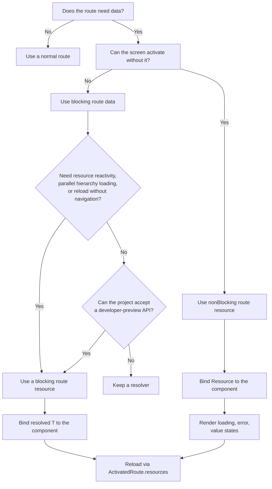

# Angular v22.2 Route Resources: Parallel Data Loading, Reloads, and Reactive Routing

Angular’s resource family has a new member: **route resources**.

Before we meet it, let’s revisit the classic Angular resolver. Resolvers prepare data before route activation, preventing users from landing on a blank page that cannot render yet. They remain useful, especially when navigation-first, sequential semantics are enough. Their trade-offs show up when parent and child work must wait on each other, or when you want signal-native reactivity and in-place refresh without rematching the route.

Angular v22.2 introduces a signal-native alternative.

A route can now define a developer-preview `resources` function alongside `resolve`. It runs in an injection context and returns a map of Angular `Resource` instances created with `resource()`, `rxResource()`, or a compatible custom implementation. The router manages their lifecycle, waits for blocking resources, binds their results to component inputs, and disposes of them with the route.

But wait a minute — a resource? Quick memory refresh or discovery moment.

Think of `Resource<T>` as a signal that handles async data for you — including its value, loading state, and errors through APIs such as `value()`, `hasValue()`, `isLoading()`, `error()`, and `status()`.

And no, Angular did not add another API merely to keep our migrations entertaining. Route resources add several capabilities that resolvers do not provide out of the box.

> ⚠️ Keep in mind that route resources are a **developer-preview feature in Angular v22.2**. Their API and behavior may change before becoming stable.

## The four powers of route resources

1. **Parallel execution**  
   Independent resources across the matched route hierarchy start concurrently.

2. **Non-blocking loading**  
   A route can activate immediately while selected resources continue loading.

3. **Reload without renavigation**  
   Refresh one resource without rematching the route or rerunning guards.

4. **Signal-based reactivity**  
   Resources can react to route parameters, query parameters, fragments, route data, and other signals.

## Setup

Route resources are opt-in. Enable both the route-resource feature and component input binding:

```ts
import { ApplicationConfig } from '@angular/core';
import { provideRouter, withComponentInputBinding, withRouterResources } from '@angular/router';

import { routes } from './app.routes';

export const appConfig: ApplicationConfig = {
  providers: [provideRouter(routes, withComponentInputBinding(), withRouterResources())],
};
```

`withRouterResources()` enables the route configuration API. `withComponentInputBinding()` binds a resource key such as `project` to a matching component input.

Here is a basic blocking resource, as in the demo under `/resources-demo/projects/:projectId`:

```ts
import { inject, resource } from '@angular/core';
import { Routes } from '@angular/router';

import { BlockingProject } from './blocking-project';
import { ProjectApiService } from './project.service';

export const projectResourceRoutes: Routes = [
  {
    path: 'projects/:projectId',
    component: BlockingProject,
    resources: (ctx) => {
      const api = inject(ProjectApiService);
      return {
        project: resource({
          params: () => ctx.params()['projectId'],
          loader: ({ params: projectId }) => api.fetchProject(projectId, 250),
        }),
      };
    },
  },
];
```

The resource key and component input name must match:

```ts
import { Component, input } from '@angular/core';

import { Project } from './models';

@Component({
  template: `
    @if (project(); as p) {
      <h2>Blocking project {{ p.id }}</h2>
      <p>User: {{ p.user }}</p>
      <p>Status: {{ p.status }}</p>
    } @else {
      <p>Waiting for blocking resource value…</p>
    }
  `,
})
export class BlockingProject {
  /** Bound as T by the router once the blocking resource has a value. */
  project = input<Project>();
}
```

Because this resource is **blocking**, the component receives the resolved `Project`, not `Resource<Project>`.

In Angular 22.2.0, that binding can arrive after `ngOnInit`. The demo logs `(not bound yet)` in `ngOnInit`, then a bound value in `afterNextRender`. Prefer an optional `input<Project>()` plus `@if`, as above, rather than eagerly reading `input.required<Project>()` in early lifecycle hooks. Resolver-bound screens in the same demo already have their value when `ngOnInit` runs.

The `resources` function may also be asynchronous, for example when dynamically importing a loader before creating the resources:

```ts
resources: async (ctx) => {
  const { fetchProject } = await import('./project-loader');

  return {
    project: resource({
      params: () => ctx.params()['projectId'],
      loader: ({ params: projectId }) => fetchProject(projectId),
    }),
  };
},
```

## Resolver versus route resource

### Waterfall versus parallel execution

Imagine a project page containing a nested document page:

```
/resources-demo/projects/:projectId/documents/:documentId
```

The project request takes approximately 250 ms. The document request takes approximately 400 ms.

With classic resolvers:

```ts
import { inject } from '@angular/core';
import { ActivatedRouteSnapshot, RouterStateSnapshot, Routes } from '@angular/router';

import { ProjectApiService } from './project.service';
import { ResolverDocument } from './resolver-document';
import { ResolverProject } from './resolver-project';

export const projectResolverRoutes: Routes = [
  {
    path: 'projects/:projectId',
    component: ResolverProject,
    resolve: {
      project: (route: ActivatedRouteSnapshot, _state: RouterStateSnapshot) =>
        inject(ProjectApiService).fetchProject(route.paramMap.get('projectId')!, 250),
    },
    children: [
      {
        path: 'documents/:documentId',
        component: ResolverDocument,
        resolve: {
          document: (route: ActivatedRouteSnapshot, _state: RouterStateSnapshot) =>
            inject(ProjectApiService).fetchDocument(
              route.parent?.paramMap.get('projectId') ?? route.paramMap.get('projectId')!,
              route.paramMap.get('documentId')!,
              400,
            ),
        },
      },
    ],
  },
];
```

Resolver route nodes run parent-to-child. The child resolver does not start until the parent route’s resolvers have completed:

```
Project resolver:  |--- 250 ms ---|
Document resolver:                  |------ 400 ms ------|
Total:             approximately 650 ms
```

There is an important nuance: multiple resolver keys on the **same route node** are processed concurrently. The waterfall occurs across the matched parent-to-child route hierarchy.

Now express those independent requests as route resources:

```ts
import { inject, resource } from '@angular/core';
import { Routes } from '@angular/router';

import { BlockingProject } from './blocking-project';
import { DocumentDetail } from './document-detail';
import { ProjectApiService } from './project.service';

export const projectResourceRoutes: Routes = [
  {
    path: 'projects/:projectId',
    component: BlockingProject,
    resources: (ctx) => {
      const api = inject(ProjectApiService);
      return {
        project: resource({
          params: () => ctx.params()['projectId'],
          loader: ({ params: projectId }) => api.fetchProject(projectId, 250),
        }),
      };
    },
    children: [
      {
        path: 'documents/:documentId',
        component: DocumentDetail,
        resources: (ctx) => {
          const api = inject(ProjectApiService);
          return {
            document: resource({
              params: () => ({
                projectId: ctx.params()['projectId'] as string,
                documentId: ctx.params()['documentId'] as string,
              }),
              loader: ({ params }) => api.fetchDocument(params.projectId, params.documentId, 400),
            }),
          };
        },
      },
    ],
  },
];
```

Resources across the matched route hierarchy are configured and awaited concurrently:

```
Project resource:  |--- 250 ms ---|
Document resource: |------ 400 ms ------|
Total:             approximately 400 ms
```

That is what the demo shows: approximately 650 ms with parent-and-child resolvers versus approximately 400 ms with route resources.

This improvement applies when the requests are independent. Parallelism cannot remove a real data dependency; if loading the document genuinely requires the project response, model that dependency explicitly rather than racing the requests.

## Blocking resources

Route resources are blocking by default. The router waits for them to settle before activation.

```ts
resources: (ctx) => ({
  project: resource({
    params: () => ctx.params()['projectId'],
    loader: ({ params: projectId }) => api.fetchProject(projectId, 250),
  }),
}),
```

The component receives the resolved value:

```ts
@Component({
  template: `
    @if (project(); as p) {
      <h2>Blocking project {{ p.id }}</h2>
      <p>User: {{ p.user }}</p>
    }
  `,
})
export class BlockingProject {
  project = input<Project>();
}
```

The component does not observe loading or error states for this resource:

- Loading happens before activation.
- A successful load binds `Project`.
- A failed load prevents activation and produces a router error.

Use blocking resources when the page cannot function meaningfully without the data.

## Non-blocking resources

Wrap a resource in `nonBlocking()` when the route should activate immediately:

```ts
import { inject, resource } from '@angular/core';
import { nonBlocking, Routes } from '@angular/router';

import { NonBlockingProject } from './nonblocking-project';
import { ProjectApiService } from './project.service';

export const routes: Routes = [
  {
    path: 'nonblocking/projects/:projectId',
    component: NonBlockingProject,
    resources: (ctx) => {
      const api = inject(ProjectApiService);
      return {
        project: nonBlocking(
          resource({
            params: () => ctx.params()['projectId'],
            loader: ({ params: projectId }) => api.fetchProject(projectId, 800),
          }),
        ),
      };
    },
  },
];
```

A non-blocking input receives the resource object rather than only its value. Type it as the public `Resource<Project>`:

```ts
import { Component, inject, input, Resource } from '@angular/core';
import { ActivatedRoute } from '@angular/router';

import { Project } from './models';

@Component({
  template: `
    <p>Status: {{ project().status() }}</p>

    @if (project().isLoading()) {
      <p>Loading…</p>
    } @else if (project().error(); as err) {
      <p role="alert">Error: {{ errorMessage(err) }}</p>
    } @else if (project().hasValue()) {
      <h3>Project {{ project().value().id }}</h3>
      <p>User: {{ project().value().user }}</p>
    }

    <button type="button" (click)="reload()">Reload without renavigation</button>
  `,
})
export class NonBlockingProject {
  private readonly route = inject(ActivatedRoute);

  project = input.required<Resource<Project>>();

  reload() {
    this.route.resources?.['project']?.reload();
  }

  errorMessage(err: unknown) {
    return err instanceof Error ? err.message : String(err);
  }
}
```

Public `Resource<T>` exposes the state-reading APIs (`status()`, `isLoading()`, `error()`, `value()`, and so on). It does **not** declare `reload()` on the public interface. For both blocking and non-blocking route resources, call reload through `ActivatedRoute.resources` (see the next section). The router’s `ResourceResult` map is where the reloadable instance lives.

Non-blocking resources are useful for secondary panels, recommendations, analytics, comments, or other content that should not delay the entire screen.

## Reload without renavigation

Resolvers run as part of navigation. A qualifying navigation can rerun them; components can also refresh data through their own services without involving a resolver at all. What resolvers do **not** give you is an isolated “refresh this route-owned loader” API on the current URL.

Route resources do. Call `.reload()` when you want a Refresh button on the current project without leaving the route.

For a blocking resource, the component input contains only `T` (`Project` in this example). Obtain the resource through `ActivatedRoute.resources`:

```ts
import { Component, inject, input } from '@angular/core';
import { ActivatedRoute } from '@angular/router';

import { Project } from './models';

@Component({
  template: `
    @if (project(); as p) {
      <h2>Blocking project {{ p.id }}</h2>
      <button type="button" (click)="reload()">Reload via ActivatedRoute.resources</button>
    }
  `,
})
export class BlockingProject {
  private readonly route = inject(ActivatedRoute);

  project = input<Project>();

  reload() {
    const ok = this.route.resources?.['project']?.reload();
    // Log or surface `ok` if you need to know whether the router accepted the reload.
  }
}
```

Use the same pattern for non-blocking resources. Even though the input is `Resource<Project>`, reload through the route map rather than inventing a wider input type:

```ts
reload() {
  const ok = this.route.resources?.['project']?.reload();
}
```

Reloading one resource does **not** emit a new `NavigationStart`. It does not rematch the URL or rerun guards. Path-parameter navigations still run guards by default; query-parameter-only changes do not unless you configure `runGuardsAndResolvers` (or related options) to do so. Either way, the backend must still authorize the request — client-side reload is not an authorization boundary.

The resource exposed by the router is read-only from the application’s perspective. You can inspect its signals and request a reload, but the router does not expose `set()` or `update()`. This keeps route-owned state coordinated with navigation.

## Redirecting from a blocking resource

A blocking loader can redirect by throwing a `RedirectCommand`:

```ts
import { inject, resource } from '@angular/core';
import { RedirectCommand, Router, Routes } from '@angular/router';

import { ProjectSummary } from './project-summary';
import { ProjectApiService } from './project.service';

export const routes: Routes = [
  {
    path: 'redirect/projects/:projectId',
    component: ProjectSummary,
    resources: (ctx) => {
      const api = inject(ProjectApiService);
      const router = inject(Router);
      return {
        project: resource({
          params: () => ctx.params()['projectId'],
          loader: async ({ params: projectId }) => {
            if (projectId === 'missing') {
              throw new RedirectCommand(router.parseUrl('/not-found'));
            }
            return api.fetchProject(projectId, 150);
          },
        }),
      };
    },
  },
];
```

This cancels the current navigation and starts the redirect. In the demo, `/resources-demo/redirect/projects/missing` lands on the not-found screen via that path.

## The frozen-state mechanic

Router resources are transactional during navigation.

Suppose a user is viewing `/resources-demo/freeze/projects/1`, and Angular reuses the same component while navigating to `/resources-demo/freeze/projects/2`.

The sequence is:

1. Project 1 is visible.
2. `NavigationStart` snapshots and freezes the exposed resource state.
3. The resource begins loading project 2, but the reused component continues showing project 1.
4. When navigation succeeds, `NavigationEnd` unfreezes the resource and reveals project 2.

This prevents the old page from flashing into a loading state during a pending navigation.

If navigation is cancelled and the route parameters roll back, the router keeps the previous snapshot visible while the restored resource settles. This avoids a second loading flash during recovery.

A reload request made while the resource is frozen returns `false`:

```ts
navigateThenReload(currentId: string) {
  const next = currentId === '1' ? '2' : '1';
  void this.router.navigate(['/resources-demo/freeze/projects', next]);
  const ok = this.route.resources?.['project']?.reload();
  // During the pending navigation, expect `ok === false`.
}
```

This restriction prevents an application-triggered reload from interfering with navigation transition tracking.

## Errors and cancellation

### Blocking errors

When a blocking resource fails:

- The router emits `NavigationError`.
- Navigation does not complete.
- The destination component is not activated.

Handle these errors through your router-level navigation error strategy, or convert expected “not found” cases into a `RedirectCommand`. The demo’s `/resources-demo/error-blocking` route uses a failing loader to show the cancel-navigation path.

### Non-blocking errors

When a non-blocking resource fails:

- Navigation still completes.
- The component remains active.
- The error is available through the resource’s `error()`.

That lets the page render a local retry or fallback state, as on `/resources-demo/error-nonblocking`.

### Forward the abort signal

A resource loader receives an `abortSignal`. In production, forward it to `fetch()` or to an API abstraction that supports cancellation whenever cancellation matters:

```ts
resource({
  params: () => ctx.params()['projectId'],
  loader: ({ params: projectId, abortSignal }) =>
    api.fetchProject(projectId, 2000, { signal: abortSignal }),
}),
```

The demo forwards `abortSignal` only on the abort lab route (`/resources-demo/abort/projects/:projectId`) so the timeline makes cancellation obvious. Basic parallel and blocking examples omit it on purpose for teaching clarity — that is not a recommendation to skip it in real apps.

When a newer navigation supersedes the current one, or route state rolls back, the pending load can then be aborted cleanly.

Resources are intended for reads. Avoid using a cancellable resource loader for mutations whose partial cancellation could leave server state ambiguous.

## `ResourceContext` and reactive route data

The route’s `resources` function receives a `ResourceContext` containing four signals:

- `params`: path and matrix parameters available to the route
- `queryParams`: query parameters
- `fragment`: the URL fragment
- `data`: static route data

A resource’s `params` function can read these signals. The returned parameter value determines when the resource reloads.

### Fine-grained query parameters

The official guide’s intent is clear: read only the key you need so an unrelated query change does not refetch. In Angular 22.2.0, reading `ctx.queryParams()['category']` **inline** inside `resource({ params: ... })` still depends on the whole `queryParams` object signal, so changing `sort` can rerun a category loader too.

The reliable pattern in the demo is to wrap each key in `computed()` before handing it to `resource`:

```ts
import { computed, inject, resource } from '@angular/core';
import { Routes } from '@angular/router';

import { QueryParamsLab } from './query-params-lab';
import { ProjectApiService } from './project.service';

export const routes: Routes = [
  {
    path: 'query',
    component: QueryParamsLab,
    resources: (ctx) => {
      const api = inject(ProjectApiService);
      const category = computed(() => ctx.queryParams()['category'] ?? 'all');
      const sort = computed(() => ctx.queryParams()['sort'] ?? 'asc');

      return {
        byCategory: resource({
          params: category,
          loader: ({ params }) => api.fetchByCategory(params),
        }),
        bySort: resource({
          params: sort,
          loader: ({ params }) => api.fetchBySort(params),
        }),
        // Contrast: inline read depends on the whole queryParams object signal.
        byCategoryInline: resource({
          params: () => ctx.queryParams()['category'] ?? 'all',
          loader: ({ params }) => api.fetchByCategory(params, 'category-inline'),
        }),
      };
    },
  },
];
```

Treat the inline gotcha as a version-specific / developer-preview nuance, not as “fine-grained tracking is impossible.” Use the `computed()` pattern to achieve the documented intent: change `sort` and `byCategory` stays put; change `category` and only the category loaders that actually depend on it run.

Also prefer reading specific properties (or a `computed` of those properties) over returning an entire `params` / `queryParams` object, which is a new object on every navigation even when individual values are unchanged.

## Limitations and caveats

### It is still a developer preview

Do not assume complete API stability.

### It is not a mandatory resolver replacement

Resolvers still work and are not going away. They are navigation-first: great when stable sequential semantics suffice. Existing resolver-based routes do not need immediate migration.

Route resources are especially attractive when you need:

- Independent parent and child requests to run concurrently
- Local non-blocking loading states
- Signal-based reactive parameters
- Reloading without rematching the route or rerunning guards

Keep a resolver when those powers are unnecessary or when your project cannot accept a developer-preview API yet. Reach for route resources when the signal model and the four powers above are the better fit.

### Blocking and non-blocking inputs have different types

For the same logical data:

```ts
// Blocking — value T (often optional in 22.2.0 until bound)
project = input<Project>();

// Non-blocking — Resource<T>
project = input.required<Resource<Project>>();
```

Reload both through `ActivatedRoute.resources?.['project']?.reload()`. Changing a route from blocking to non-blocking therefore changes the component contract and template.

### Do not eagerly assume required router-bound inputs in early lifecycle

In Angular 22.2.0 with this demo, reading a blocking route-resource input in `ngOnInit` can still show “not bound yet”; `afterNextRender` then sees the value. Resolver screens in the same app already have resolve data in `ngOnInit`.

Treat this as a version-specific observation rather than a documented lifecycle contract. For now:

- Prefer optional `input<T>()` plus `@if` for blocking route resources when early reads matter.
- Avoid eagerly reading `input.required<T>()` in constructor effects for router-bound blocking values.
- Defer dependent work until the input is actually available.
- Add a regression test around the lifecycle behavior you rely on.

### Diagnostics require more than checking the UI

Route resources interact with navigation, cancellation, component reuse, and signal dependencies. Log router events and loader timing when diagnosing unexpected reloads or delays — the demo’s lab log is there for exactly that.

### Documentation and versions can drift

Developer-preview documentation may describe intended behavior that an early implementation achieves only with a specific pattern (such as `computed()` for query keys). Confirm examples against your installed `@angular/router` version.

## Decision guide



In short:

- Choose a **blocking resource** when the destination cannot render without the result.
- Choose a **non-blocking resource** when the page should render its own loading and error states.
- Reload through **`ActivatedRoute.resources`** for both shapes.
- Keep a **resolver** when stable, navigation-first semantics are sufficient or preview APIs are not acceptable.
